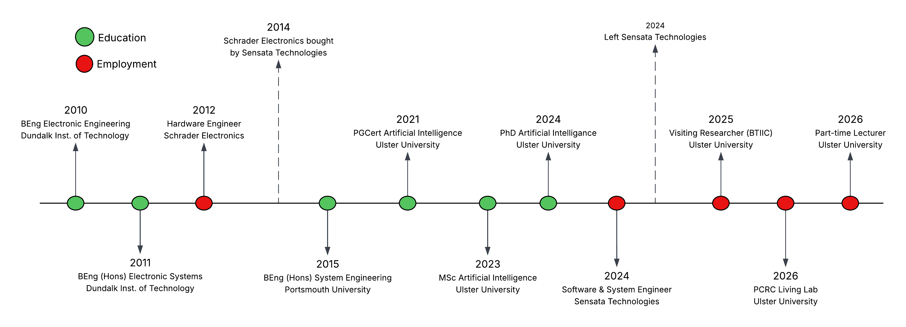
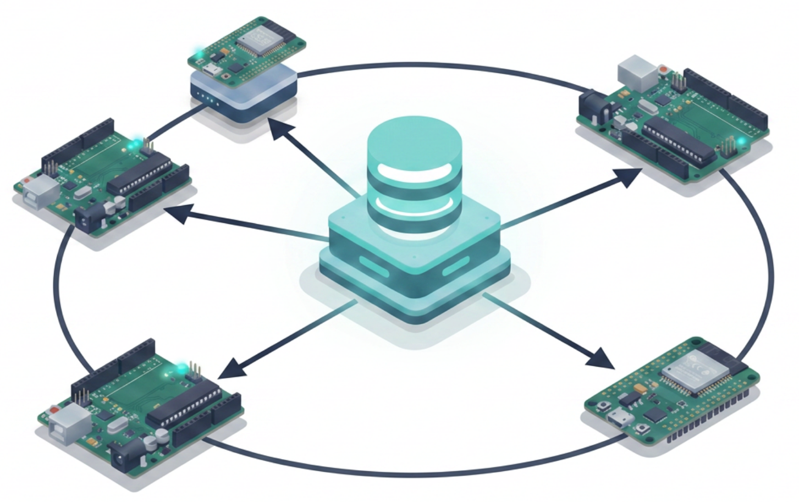

# Introduction

## Aim

::: {style="text-align: center"}
> "Federated learning? Oh yeah, I heard this amazing talk about that. Go ahead, ask me anything".
:::

::: {.fragment style="text-align: center"}
> "Federated learning? Oh yeah, I went to a talk on that by some random. It was complicated, but I got the gist."
:::

## About Me
{.r-stretch width=90%}

## My PhD

::: {style="text-align: center; margin-top: 5em"}
A Trustworthy Federated Learning Framework for Constrained
Devices Operating at the Network's Edge
:::

# Core Principles

## What is Federated Learning

:::: {.columns}

::: {.column width="55%" style="margin-top: 4em"}

:::

::: {.column width="45%"}
::: {.small}
::: {.callout-tip title="Federated Learning"}
[**Federated learning** (FL) is a privacy preserving, decentralised appraoch to training machine learning models.]{.smaller}
:::

::: {.callout-tip title="Transmitting Data"}
Instead of a device or organisation sending data to a central location to be used in model traning, the model is sent to the device, and it is trained locally, using local data.
:::

::: {.callout-tip title="Model Updates"}
When trained, the client will send the model updates back to the central location, keeping the data on the device.
:::
:::
:::

::::

## FL Animation



# 
::: {style="text-align: center; margin-top: 5em"}

Key point:

The data **never** leaves the client. Only the model updates are transmitted, and aggregated into a new global model, which is returned to the client for further training.
:::

## Why do Machine Learning in a Federated Way?

::: {style="text-align: center; margin-top: 4em"}

:::: {.columns}
::: {.column width="50%"}
::: {.fragment}
::: {.callout-tip title="Privacy & security" appearance="simple"}
Raw data never leaves the device.
:::
:::
::: {.fragment}
::: {.callout-tip title="Scalability" appearance="simple"}
Training spreads across many clients.
:::
:::
:::
::: {.column width="50%"}
::: {.fragment}
::: {.callout-tip title="Generalisation" appearance="simple"}
Learns from diverse, real-world data.
:::
:::
::: {.fragment}
::: {.callout-tip title="Efficiency" appearance="simple"}
Uses compute already at the edge.
:::
:::
:::
::::

:::

